<div align="center">

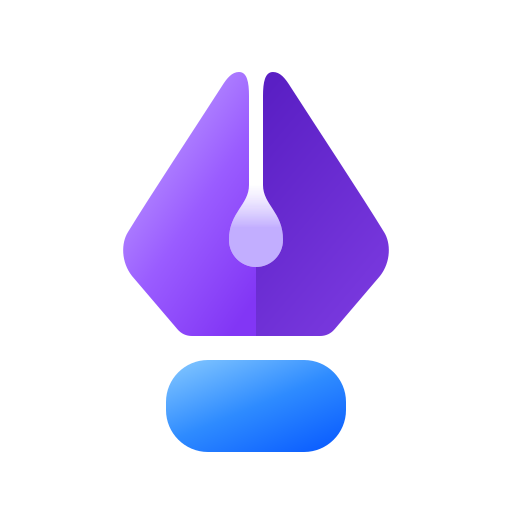

# Zenith PDF

**Read, mark up and study PDF documents on Windows, macOS and Linux.**<br>
Thirty-eight markup tools with a menu each, page management, PDF tools, forms, flashcards, reading aloud,<br>
and an assistant, in fifteen languages. Everything runs on your computer.

Completely free and open source, with no account, no ads and no paid version.<br>
In continuous development: new versions come out often.

<a href="https://github.com/andrealo20/Zenith-PDF/releases/latest/download/Zenith-PDF-Setup.exe"></a>
&nbsp;
<a href="https://github.com/andrealo20/Zenith-PDF/releases/latest/download/Zenith-PDF-macOS.dmg"></a>
&nbsp;
<a href="https://github.com/andrealo20/Zenith-PDF/releases/latest/download/Zenith-PDF-Linux-x86_64.AppImage"></a>

<sub>Windows 10 and 11, 64-bit &nbsp;·&nbsp; macOS on Apple silicon &nbsp;·&nbsp; Linux x86-64 &nbsp;·&nbsp; <a href="https://github.com/andrealo20/Zenith-PDF/releases">all releases</a></sub>

<br>

[](https://github.com/andrealo20/Zenith-PDF/actions/workflows/build.yml)


<br>

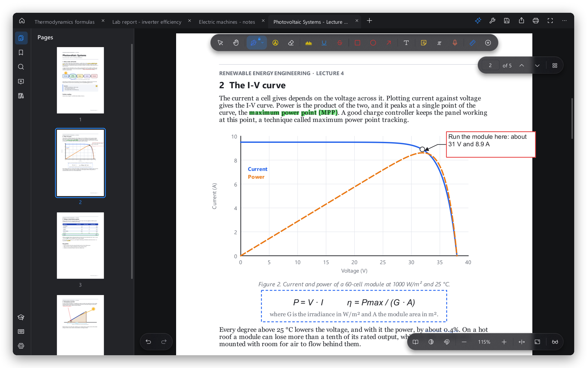

</div>

## A quick tour

### Light or dark

Pick a theme, or let Zenith PDF follow the system, and an accent colour of your own. The floating bars are
frosted glass: the pages show through, blurred, and the text on them stays easy to read.

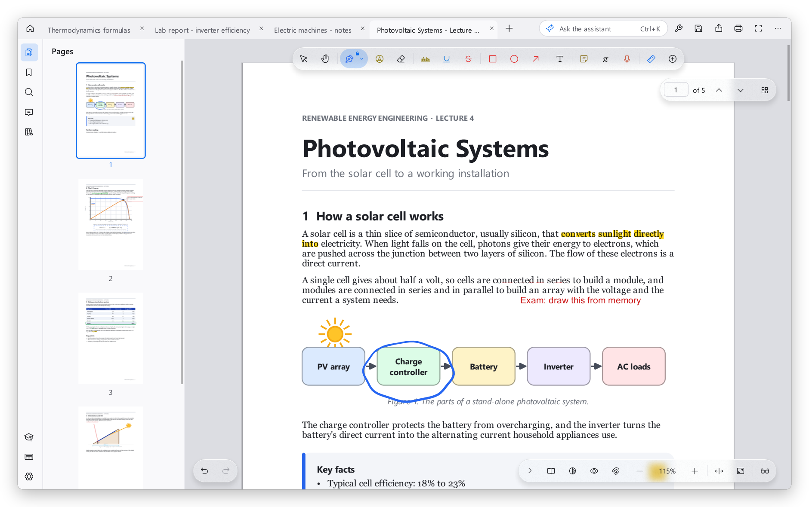

### Home

Every file you opened, with a thumbnail, its folder, its pages and when you last read it. Star the ones you
need, tag them, pin the folders you use, and start a new document, the Doc Builder or a PDF tool from the
cards at the top.

<table>
  <tr>
    <td width="50%">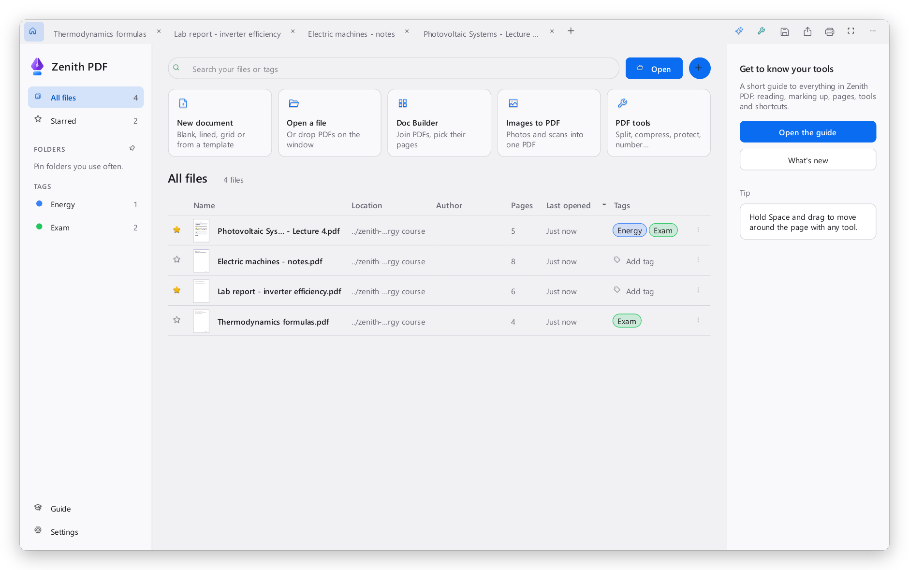</td>
    <td width="50%">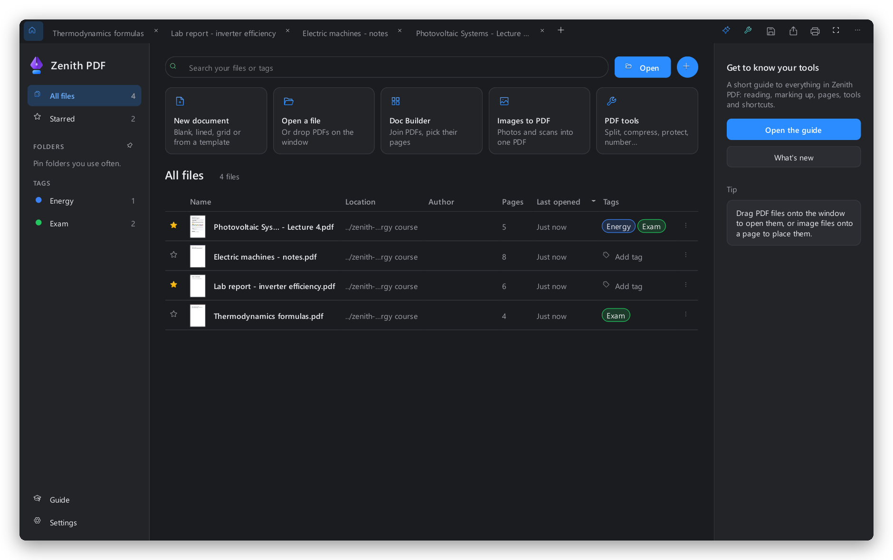</td>
  </tr>
</table>

### Settings

Changes apply the moment you make them: theme and accent colour, how clear the glass is, the tools and their
locks, navigation, saving, text recognition, help. The search box finds any setting by name, and so does
the assistant.

<table>
  <tr>
    <td width="50%">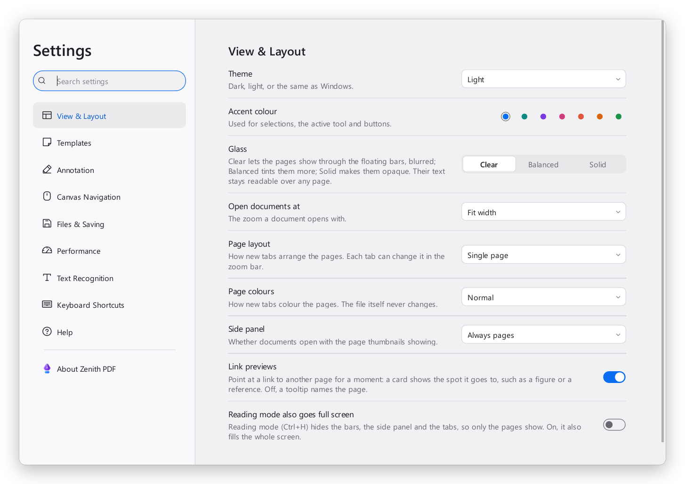</td>
    <td width="50%">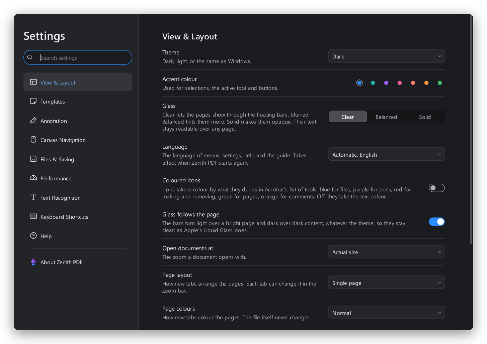</td>
  </tr>
</table>

### Every tool has its own menu

Click the tool that is on, and its menu opens under it: colour, thickness, opacity, line style and ends,
fill, pens that thin out when you go fast, ink that turns into clean lines and shapes. The lock keeps a tool
on to draw again, or lets it go back to Select after one use. The pin keeps the menu open while you draw.

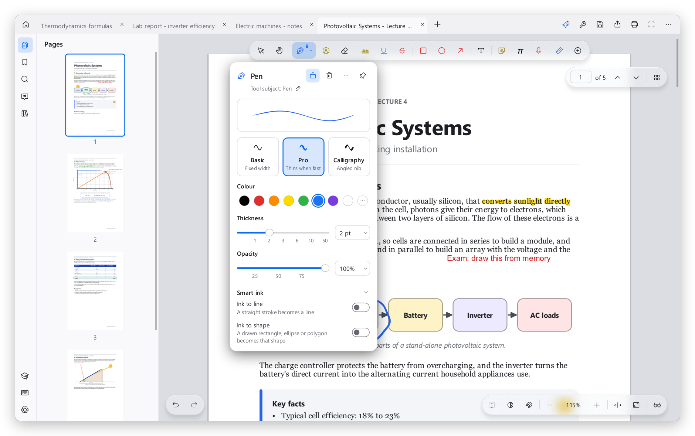

### Thirty-eight tools, your toolbar

Pens, highlighter, eraser, study tape and a laser pointer; lines, arrows, shapes and clouds; text marks, text
boxes, callouts, stamps and redaction; distance, perimeter, area, angle and volume at a drawing's scale; notes,
signatures, pictures, links, voice notes and LaTeX equations. Pick the ones you use, drag them where you want them, keep copies of
a tool with different styles.

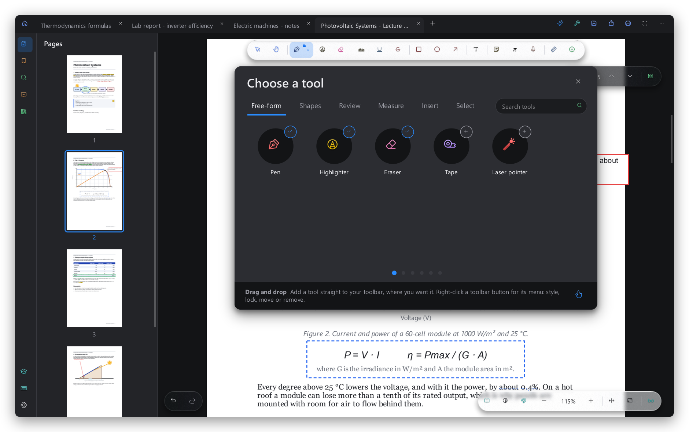

### Ask for anything: Ctrl+K (⌘K on a Mac)

Type what you want to do, in any of the app's fifteen languages, and press Enter. The
assistant finds tools, commands, settings, keyboard shortcuts and chapters of the guide, forgives typos, and
remembers what you use. It needs no internet and no language model.

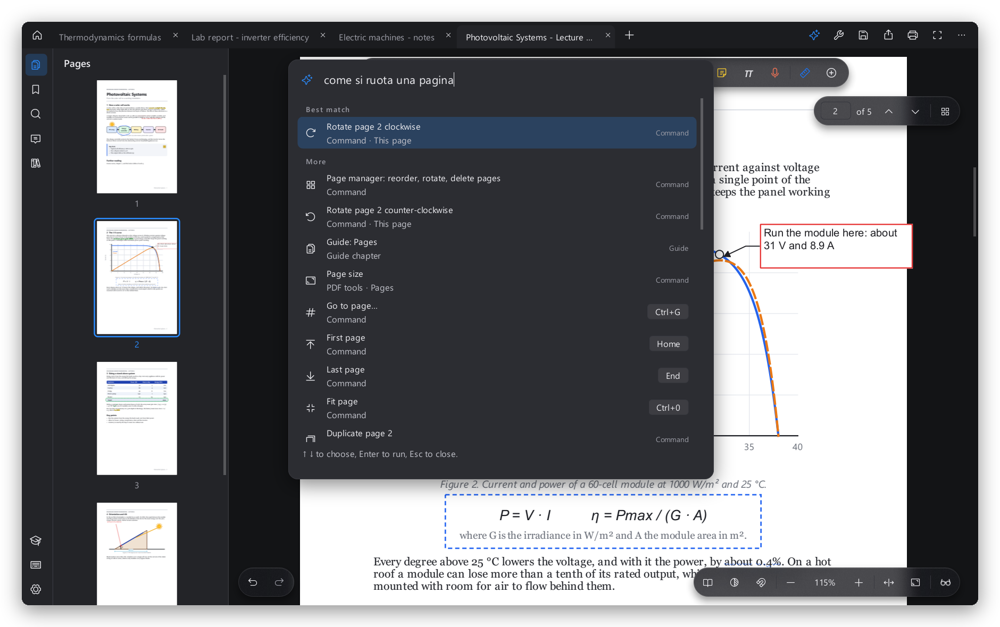

### Made for studying

Every highlight and underline, with the text under it and your comments, becomes study notes by page or by
colour, ready to save as Markdown. Text boxes and notes get a spelling and punctuation check, with the
system's own spell checker. Tape hides answers until you peel it back.

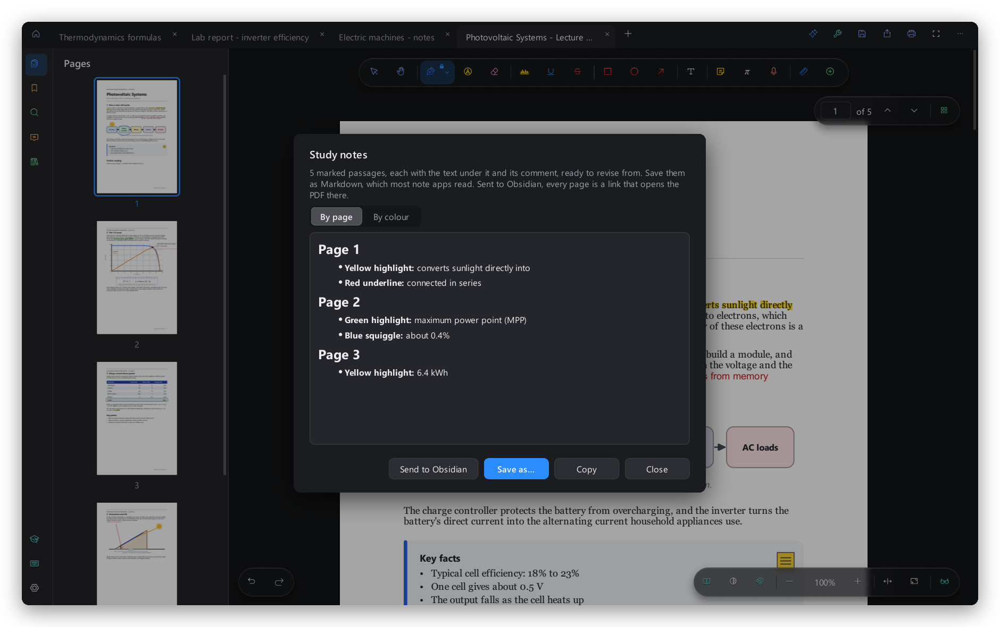

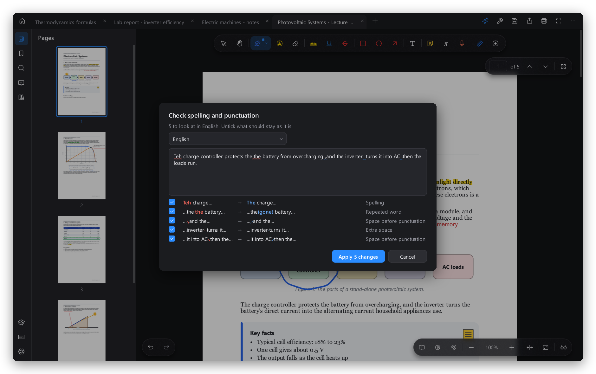

### Pages, and only the pages

The page manager reorders, rotates, duplicates, extracts and deletes pages. Reading mode (Ctrl+H) takes the
bars, the panels and the tabs away, and brings them back as they were.

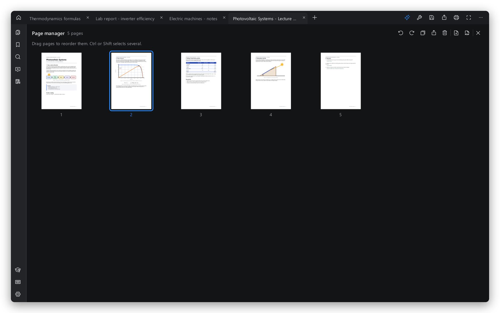

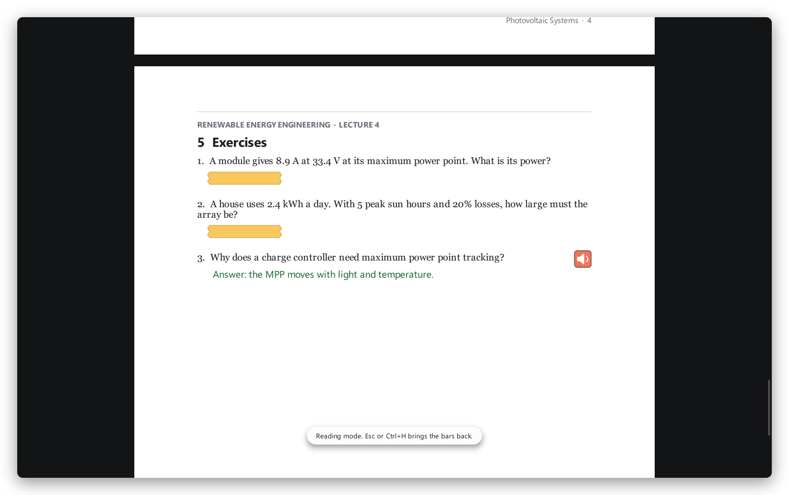

### In your language

Menus, settings, help and the whole guide in English, Italian, French, Spanish, German, Portuguese, Dutch, Polish, Czech, Turkish, Russian, Ukrainian, Chinese, Japanese or Korean. Zenith
PDF speaks the system's language when it knows it; Settings > View & Layout picks another one.

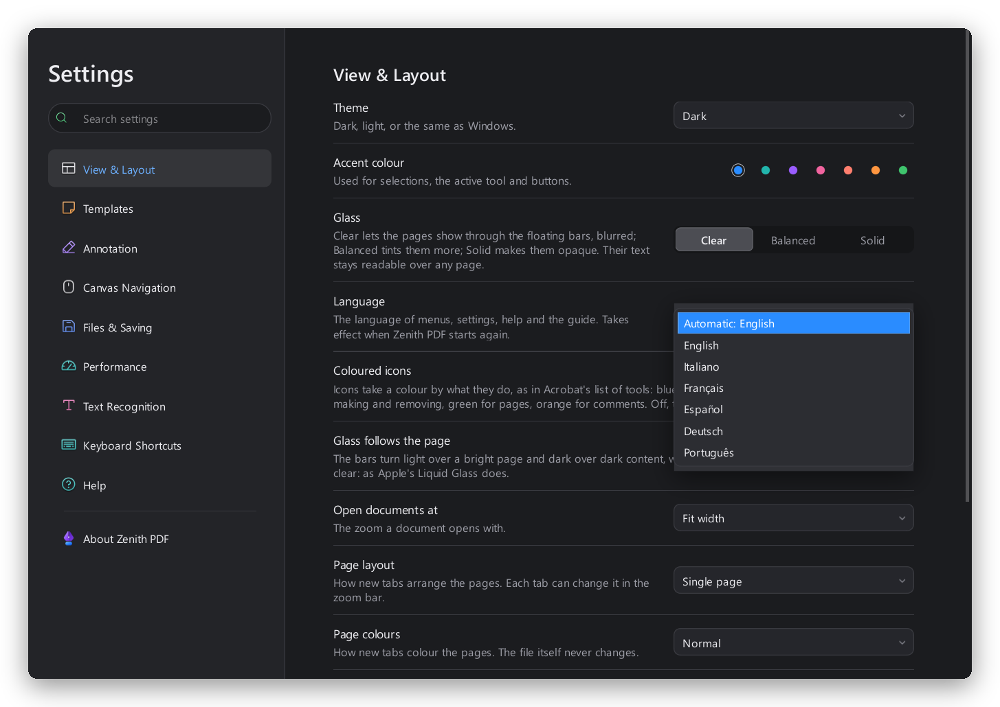

### Flashcards, and two versions side by side

The highlights of a lecture become flashcards: the comment asks and the marked words answer, or the words go
missing from their sentence. Study them here, or save them for Anki. Compare with another version opens two
PDFs side by side, with what was added, removed or changed marked on both and listed beside them.

<table>
  <tr>
    <td width="50%">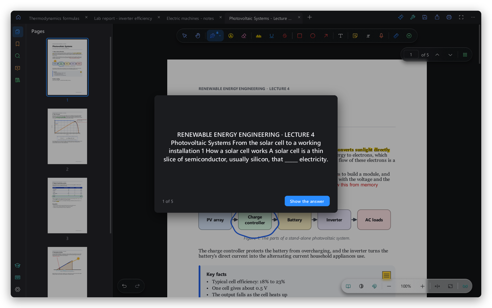</td>
    <td width="50%">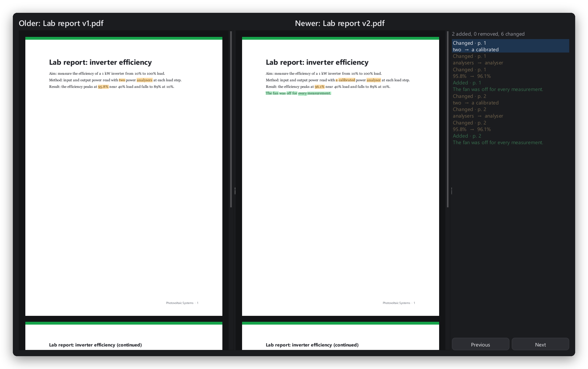</td>
  </tr>
</table>

### New in 0.6

- Text boxes in Helvetica, Times or Courier, bold, italic or underlined, aligned left, centred or right.
- Stamps: APPROVED, DRAFT, CONFIDENTIAL and more, or your own words, with who stamped them and when.
- Proofreading marks on selected text: insert, replace, or mark for redaction.
- Groups, alignment, even spacing and flipping; a brush that copies one annotation's look, and an eyedropper.
- Angles and volumes among the measurements; shapes filled with hatching, cross-hatching or dots.
- A view menu: hide the annotations, a grid or ruled lines over the pages, the PDF's layers, a locked zoom, read
  only, and touch mode.
- Word, Excel, PowerPoint, OpenDocument and RTF files open as PDFs, with LibreOffice or Microsoft Office, and so
  do text, Markdown and web pages.
- Nine more languages: Dutch, Polish, Czech, Turkish, Russian, Ukrainian, Chinese, Japanese and Korean.

## Download and install

Zenith PDF is free to download, use, share and change, on every system: the whole source is here, under the
GPL. It is in continuous development, and each version lists its changes on the
[releases page](https://github.com/andrealo20/Zenith-PDF/releases).

**Windows.** Download [Zenith-PDF-Setup.exe](https://github.com/andrealo20/Zenith-PDF/releases/latest/download/Zenith-PDF-Setup.exe) and run
it. The installer asks where to put Zenith PDF, whether you want a desktop shortcut and whether it should
open your PDF files, then adds it to the Start menu and to Open with. Windows lets no program make itself the
default: for that, its Default apps settings open at Zenith PDF, and Set default there finishes it. It uninstalls from Settings > Apps, like any other app. While the
installer is not signed yet, SmartScreen may say it protected your PC: choose More info, then Run anyway.

**macOS.** Open [Zenith-PDF-macOS.dmg](https://github.com/andrealo20/Zenith-PDF/releases/latest/download/Zenith-PDF-macOS.dmg) and drag
Zenith PDF onto Applications. The app is not notarized by Apple yet, so the first time macOS won't open it:
go to System Settings > Privacy & Security and choose Open Anyway. It is built for Apple silicon (M1 and
later). Text recognition uses Vision and spelling the Mac's own spell checker.

**Linux.** Download [Zenith-PDF-Linux-x86_64.AppImage](https://github.com/andrealo20/Zenith-PDF/releases/latest/download/Zenith-PDF-Linux-x86_64.AppImage),
make it executable and start it:

```
chmod +x Zenith-PDF-Linux-x86_64.AppImage
./Zenith-PDF-Linux-x86_64.AppImage
```

AppImages need FUSE 2 (`sudo apt install libfuse2`, or `libfuse2t64` on Ubuntu 24.04). Text recognition uses
Tesseract and spelling the Hunspell dictionaries, when they are installed: for Italian on Ubuntu or Debian,
`sudo apt install tesseract-ocr tesseract-ocr-ita hunspell-it`.

**From source**, on any of the three, with Python 3.11 or later:

```
python -m venv .venv
.venv/bin/pip install -e ".[dev]"
.venv/bin/python -m zenith_pdf [file.pdf ...]
```

(On Windows the folder is `.venv\Scripts` instead of `.venv/bin`.)

**Building the downloads.** `pip install -e ".[build]"`, then `python tools/build.py` makes the download of
the system it runs on, in `dist/release`: the installer on Windows (it needs [NSIS](https://nsis.sourceforge.io)),
the .dmg on macOS, the AppImage on Linux (it needs appimagetool). GitHub Actions builds and tests all three on
every change, and publishes them with each new version.

## How it's built

| Part | Built on |
| --- | --- |
| Window, widgets, painting | Qt 6 through PySide6, the Fusion style with its own style sheet, dark and light |
| Reading and drawing pages | PDFium through pypdfium2, in a pool of processes sharing the file through shared memory |
| Writing the PDF | qpdf through pikepdf: standard annotations with appearance streams, encryption kept |
| Pictures and compression | Pillow |
| Icons | Phosphor through QtAwesome, plus a few drawn by hand |
| Text recognition | Windows.Media.Ocr through the winrt packages; Vision through pyobjc on macOS; Tesseract on Linux |
| Spelling | ISpellChecker on Windows, through ctypes; NSSpellChecker on macOS; Hunspell through pyenchant on Linux |
| Voice notes | waveIn and MCI from winmm on Windows, through ctypes; Qt Multimedia on macOS and Linux |
| Camera | the Windows Camera app; on macOS and Linux a live view through Qt Multimedia |
| Assistant | its own search over the app's names in every language, and a vocabulary in six: no language model, nothing sent anywhere |
| Languages | its own catalogue: every text of the app keyed by its English, one JSON file per language |
| Reading aloud | Qt TextToSpeech, with the system's voices |
| Search in every PDF | SQLite's full-text index (FTS5), kept on the computer |
| Comparing versions | the words of both versions, lined up with Python's difflib |
| Updates | GitHub's releases API; each download checked against the release's SHA256SUMS |
| Tests | pytest on Qt's offscreen platform: 674 tests, run on Windows, macOS and Linux |
| Downloads | PyInstaller, then an NSIS installer, a .dmg or an AppImage (`tools/build.py`), built by GitHub Actions |

```
src/zenith_pdf/
  core/       PDFium wrapper, coordinate mapping, render queue, PDF tools,
              the equation renderer, ink geometry, audio recording and
              playback, spelling, writing helpers, the assistant's search
              and its vocabulary (no widgets)
  ui/         main window and its windows, page canvas, tools, their menus
              and the tool chooser, side panels, home, settings, guide,
              assistant, tips, audio recorder
  locales/    the texts of the app in fourteen languages besides English, and
              the catalogue of the English ones
tests/        pytest suite; the UI tests run on Qt's offscreen platform
tools/        build.py makes the download of the system it runs on;
              screenshots.py the pictures of this README; make_icon.py the
              icon; bench_zoom.py times zooming; snapshot.py renders the
              window to a PNG; i18n.py gathers the texts to translate
packaging/    the Windows installer script and the Linux desktop entry
.github/      the workflow that tests and builds on the three systems
docs/images/  the pictures of this README
```

### Rendering

Zooming is meant to be sharp at once, not after a second of blur.

- Pages are cut into 512 px tiles (1024 px above 4x) rendered at the exact
  screen scale, only where visible. Exact tiles are copied 1:1 onto device
  pixels, aligned to the physical pixel grid even at 125% or 175% display
  scaling, so the result is identical to a native rendering.
- PDFium is not thread-safe, not even across documents, so tiles render in a
  pool of processes that read the PDF from one shared-memory copy and hand
  pixels back through shared memory as well. A thread in the app process
  renders too: it is ready while the processes start. A process that crashes
  on a malformed PDF is replaced; the app keeps running.
- Mouse-wheel zoom moves along a fixed ladder of levels. When idle, the view
  renders the neighbouring levels for the area around the cursor, so a wheel
  notch finds its tiles already made. Old levels stay cached (LRU, 384 MB).
- Each tile is rendered with a margin that is then discarded: PDFium truncates
  glyph origins towards zero, so a letter starting outside the bitmap would land
  one pixel off and show a seam.

`tools/bench_zoom.py` measures it. On a 20-thread laptop, with the window at
1400x900 and 175% scaling:

| Document | First screen sharp | Wheel notch sharp | Unprepared zoom |
| --- | --- | --- | --- |
| 21-page datasheet | 120 ms | 0 ms | 110 ms |
| A1 sheet, 40,000 vector strokes | 240 ms | 0 ms | 150 ms |

PDFium renders and extracts text; pikepdf (qpdf) writes the file. The PDF is
read into memory once, so the original can be replaced atomically on save.
Annotations are immutable values in display space (`core/annotations.py`);
an edit swaps one value for another, which keeps undo trivial. The same
geometry feeds the on-screen painter and the PDF appearance streams
(`core/appearance.py`), so a markup looks the same here and in other viewers.

### Glass

Qt can't blur what lies behind a widget, so each floating bar samples it
(`ui/widgets.py`, `FloatingBar`).

- The pages under the bar and 24 px round it are grabbed, reduced to one texel
  every 2 logical px, blurred with a gaussian (sigma 3.5 px, as three box passes)
  and given back some of the colour a tint takes away. The painter stretches
  the texels smoothly: lines of text show through as soft strokes, as through
  Apple's Liquid Glass, but too soft to read under the icons.
- A scroll moves the picture with the pages at once, so it never lags a frame;
  a fresh sample follows at most once a frame, and at once after a jump past
  the area sampled. A zoom or newly rendered tiles under a bar resample it too.
- The tint is worked out column by column: as clear as the glass style allows,
  rising only where text and icons would read under 4.5:1 (Clear) or 7:1
  (Balanced) over plain parts of the page or the canvas, or under 3:1 or 4.5:1
  over the worst spot of a busy picture.
  The faint grain that keeps the glass from banding is counted in.
- The edge and the line of light along the top are drawn in device pixels,
  whole pixels wide at every scaling from 100% to 200%.

The pictures in this README are made by `tools/screenshots.py`: it writes a demo lecture, marks it up with
the app's own tools and draws each screen offscreen, so they show no one's files.

## License

Zenith PDF is free software: you can redistribute it and modify it under the
terms of the GNU General Public License, version 3 or (at your option) any
later version. See [LICENSE](LICENSE). Copyright (C) 2026 Andrea Loroni.

The libraries it builds on keep their own licences, listed in Settings >
About: Qt and PySide6 (LGPL-3.0), PDFium through pypdfium2 (BSD-3-Clause,
Apache-2.0), qpdf through pikepdf (Apache-2.0, MPL-2.0), QtAwesome with the
Phosphor icons (MIT) and Pillow (MIT-CMU).
