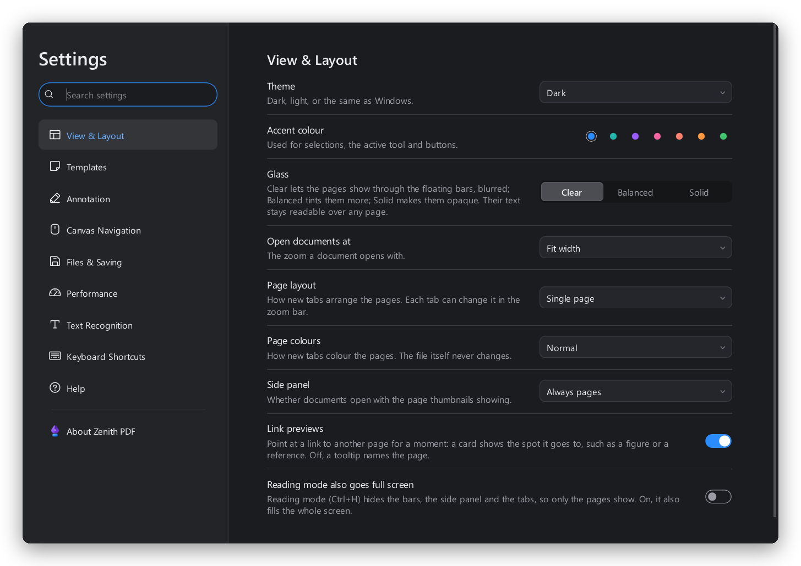

<div align="center">


# Zenith PDF

**Read, mark up and study PDF documents on Windows.**<br>
Thirty-five markup tools with a menu each, page management, PDF tools, text recognition, voice notes,<br>
and an assistant that understands six languages. Everything runs on your PC.

<a href="https://github.com/andrealo20/Zenith-PDF/releases/latest/download/Zenith-PDF.exe"></a>
&nbsp;
<a href="https://github.com/andrealo20/Zenith-PDF/releases"></a>

<sub>One file, nothing to install: download it and double-click. Windows 10 and 11, 64-bit.</sub>

<br>


<br>

<picture>
  <source media="(prefers-color-scheme: dark)" srcset="docs/images/editor-dark.png">
  
</picture>

</div>

## A quick tour

### Every tool has its own menu

Click the tool that is on, and its menu opens under it: colour, thickness, opacity, line style and ends,
fill, pens that thin out when you go fast, ink that turns into clean lines and shapes. The lock keeps a tool
on to draw again, or lets it go back to Pan after one use. The pin keeps the menu open while you draw.

<picture>
  <source media="(prefers-color-scheme: dark)" srcset="docs/images/tool-menu-dark.png">
  
</picture>

### Thirty-five tools, your toolbar

Pens, highlighter, eraser, study tape and a laser pointer; lines, arrows, shapes and clouds; text marks, text
boxes, callouts and redaction; distance, perimeter and area at a drawing's scale; notes, signatures, pictures,
links, voice notes and LaTeX equations. Pick the ones you use, drag them where you want them, keep copies of
a tool with different styles.


### Ask for anything: Ctrl+K

Type what you want to do, in English, Italian, French, Spanish, German or Portuguese, and press Enter. The
assistant finds tools, commands, settings, keyboard shortcuts and chapters of the guide, forgives typos, and
remembers what you use. It needs no internet and no language model.


### Made for studying

Every highlight and underline, with the text under it and your comments, becomes study notes by page or by
colour, ready to save as Markdown. Text boxes and notes get a spelling and punctuation check, with the
spell checker built into Windows. Tape hides answers until you peel it back.


### Pages, and only the pages

The page manager reorders, rotates, duplicates, extracts and deletes pages. Reading mode (Ctrl+H) takes the
bars, the panels and the tabs away, and brings them back as they were.


### Home and settings

The home page lists every file you opened, with stars, tags and pinned folders. Settings apply the moment
you change them: theme, accent colour, how clear the glass is, tools, navigation, saving, text recognition.

<picture>
  <source media="(prefers-color-scheme: dark)" srcset="docs/images/home-dark.png">
  
</picture>



## Download and run

**The quick way.** Download [Zenith-PDF.exe](https://github.com/andrealo20/Zenith-PDF/releases/latest/download/Zenith-PDF.exe)
and double-click it. It is a single file with everything inside, so it starts in a few seconds while it
unpacks itself. Windows may say it protects your PC because the file is not signed: choose
**More info**, then **Run anyway**.

**From source**, with Python 3.11 or later:

```
python -m venv .venv
.venv\Scripts\pip install -e .[dev]
.venv\Scripts\python -m zenith_pdf [file.pdf ...]
```

To build the executable yourself: `.venv\Scripts\pip install pyinstaller`, then
`.venv\Scripts\python tools/build_exe.py`. It lands in `dist\Zenith-PDF.exe`.

## Everything it does

- Several windows: drag a tab out of the strip and the document opens in a
  window of its own; drop it on another window to move it there (or right-click
  the tab). Every window shares the tools, their styles and the markup library
- Tabs, drag and drop to open; a home page listing every file you opened with a
  thumbnail, folder, author, page count and when you last opened it, sortable
  and searchable, with stars, tags, pinned folders and quick actions
- Reopen the last session's documents at the same page and zoom, or start
  fresh (a setting); each file also remembers where you left it
- Continuous scrolling with lazy, prioritised background rendering
- Zoom anchored under the cursor (Ctrl + wheel), presets, fit width, fit page
- Page thumbnails, bookmarks (PDF outline), full-text search with highlights
- Text selection by dragging or by double-clicking a word, with a small bar
  just above it: highlight, in a colour picked right there that the
  highlight tool keeps, underline, strikethrough, squiggle, copy, a note on
  the text (a highlight that carries it, shown when pointed at) and search
- More than thirty tools, in a tool chooser grouped as free-form (pen,
  highlighter, eraser, tape for studying, laser pointer), shapes (line,
  polyline, arrow, rectangle, ellipse, cloud, polygon), review (highlight,
  underline, squiggle, strikethrough, text cleaner, text box, callout,
  redaction), measure (distance, perimeter, area, at a drawing scale), insert
  (note, bookmark, signature, image from camera or file, hyperlink, audio note,
  equation written in LaTeX, snapshot) and select (select, lasso, pan)
- A toolbar you arrange: add tools from the chooser or by dragging them on,
  reorder by dragging, remove from the tool's menu; extra tools fold into a
  menu on narrow windows
- Every tool has its own menu: click the tool
  that is on (or right-click, or hold it) to open it. The header has the
  tool's name, a lock, remove, more (duplicate, reset, move, help) and a pin
  that keeps the menu open while drawing; under it the subject the tool's
  annotations get (written to the PDF as /Subj), a live preview painted by
  the page's own painter, and the tool's options. Every change applies at once
- A locked tool stays on to draw again; an unlocked one goes back to Pan (or
  to Select, a setting) after one use. Each tool has its own default lock
- Copies of a tool, each with its own style and subject: a yellow and a green
  highlighter side by side, told apart by the colour of their icons
- Pens: basic, pro (thinner when moving fast) and calligraphy (angled nib);
  ink that turns into a straight line or a rectangle, ellipse or polygon;
  an eraser that takes whole strokes or only the part it passes over
- Line styles (solid, dotted, dashed, dash and dot) and ten line endings on
  lines, arrows and polylines; shapes with no border or no fill; highlight
  mode, which darkens what is under a shape like a highlighter; note icons;
  laser size and fade time; tape that starts covered or peeled
- Audio notes recorded from the microphone (up to 10 minutes, with a level
  meter) or attached from a file, played in a small player next to the note
- Snapping to other annotations and to the page's text, pictures and edges,
  with guide lines; Alt places freely
- Move, resize, restyle, delete, undo and redo every annotation; lines and
  polylines have a handle on each point
- Annotations are saved as standard PDF annotations with appearance streams,
  so other viewers show them and can edit them; existing ones are imported
- Annotation list with export to CSV or plain text; copy, cut and paste
  annotations, also between documents
- Pages: add (blank, lined, grid, dotted), copy, paste, duplicate, delete,
  rotate, reorder in a page manager, extract, insert from PDF or image,
  extend the margin for notes, watermark. Annotations move with their pages and
  every change can be undone
- Selected annotations get a small bar of their own: Style (the options of the
  tool menus, for everything selected at once, one undo step per change),
  duplicate, drawing order, lock, and a menu with properties, flatten into
  the page, apply to other pages, copy as image and a markup library to reuse
  them in any document
- Pictures on the page: paste one with Ctrl+V, drag image files in, or pick
  a file. They move and resize (corners keep the proportions) and are saved
  as standard stamp annotations. Photos stay JPEG, screenshots stay lossless
- Ctrl+V pastes whatever the clipboard holds: annotations, pages, a picture,
  or text as a text box
- Redaction: mark areas, or every match of a word, then apply. Redacted pages
  become pictures of themselves with the areas filled in, so the text under
  them is gone from the file; OCR can make the rest searchable again
- PDF tools, following the list of the open source Stirling-PDF project:
  page numbers, crop (also trimming white margins), page size, pages per
  sheet, split into files, remove blank pages, reverse order, export pages as
  images or text, images to PDF, extract images, password and permissions
  (AES-256), sanitize, flatten forms, remove annotations, properties and
  metadata, attachments, compress, repair. Changes to the document can be
  undone like any edit
- Links in documents can be clicked; the hyperlink tool adds and edits them.
  Links and bookmarks land on the line they point at, not the top of the
  page, and edited links keep that spot when saved. Back (Alt+Left, the
  mouse's back button, or the chip that appears in the page counter) returns
  to where a link, a bookmark, Ctrl+G, Home or End started; Alt+Right goes
  forward again
- Pointing at a link to another page for a moment shows a card with the spot
  it goes to: the reference behind "[3]", the figure above its caption, the
  section heading. A setting turns it off
- Page thumbnails show the annotations
- A guide to the whole editor (F1), written from the same data as the in-app
  help, plus what's new and the keyboard shortcuts
- Settings with categories, search, and changes that
  apply at once (theme or follow Windows, accent colour, glass, opening
  zoom and layout, every tool's menu and lock, tool styles that are
  remembered, mouse wheel and scrolling speed, autosave, reopening the last
  documents, memory, OCR language)
- Help on every button: point at it for a moment and a card says what it does
  and how to use it
- An assistant (Ctrl+K, or the sparkle at the top right) that finds any tool,
  command, setting, keyboard shortcut or guide chapter from a few words or a
  question, in English, Italian, French, Spanish, German or Portuguese, typos
  forgiven, and runs it with Enter. It works offline, with no language model:
  a vocabulary of how people name each thing in the six languages, matched by
  whole words, beginnings and near misses, weighted by how rare a word is
- Writing help, also offline: spelling and punctuation for text boxes, callouts
  and notes (with the spell checker built into Windows, for every language it
  has a dictionary for), the key sentences of selected text or a page, kept as
  a note, and study notes gathered from every highlight and underline, by page
  or by colour, saved as Markdown
- Tips the first time each tool is used: a small card under it with two or
  three ways to use it well, shown once and gone as soon as the tool is used
- Doc Builder: combine several PDFs, drag files and pages into order, rotate,
  delete, duplicate, insert blank pages, extract a selection, build the result
- New documents and saved templates (paper, orientation, ruling, length);
  pinned folders
- Floating bars of frosted glass that blur the pages scrolling under them,
  with their colours lifted; the tint rises only where the page under a bar
  needs it for text to read at 7:1 (4.5:1 over a bright spot of a photo).
  Clear, Balanced or Solid in the settings; menus and panels are solid
- Reading mode (Ctrl+H): only the pages, with the bars, the side panel and the
  tabs out of the way. Scrolling, zoom, links, Back and the page keys work as
  always; Esc brings everything back as it was. It can also fill the screen
- Text recognition (OCR) with the engine built into Windows: scanned pages
  become searchable and selectable
- Printing with annotations
- Single, two-page and book layouts; normal, dark and sepia page colours
- Password-protected documents (encryption is kept when saving)
- Dark and light themes

## Keyboard shortcuts

| Keys | Action |
| --- | --- |
| Ctrl+O | Open |
| Ctrl+S / Ctrl+Shift+S | Save / save as |
| Ctrl+Z / Ctrl+Y | Undo / redo |
| V / H | Select tool / pan tool |
| F6 | Go to the toolbar: arrow keys move, Enter turns a tool on or opens its menu, the Menu key opens any tool's menu |
| Space (hold), middle button | Pan with any tool |
| Shift while drawing | Square, circle, 45° lines |
| Delete, Esc | Delete selection, cancel or deselect |
| Double-click on text | Select a word |
| Ctrl+C / Ctrl+X | Copy, cut annotations (Ctrl+C copies selected text too) |
| Ctrl+V | Paste annotations, copied pages, a picture or text |
| Ctrl+P | Print |
| Ctrl+W | Close tab |
| Ctrl+Tab / Ctrl+Shift+Tab | Next / previous tab |
| Ctrl+Shift+N, or drag a tab out | New window / the document in a window of its own |
| Ctrl+F, F3, Shift+F3 | Search, next / previous result |
| Ctrl+= / Ctrl+- | Zoom in / out |
| Ctrl+1 / Ctrl+0 / Ctrl+2 | Actual size / fit page / fit width |
| Ctrl+G | Go to page |
| Home / End | First / last page |
| Alt+Left / Alt+Right, mouse side buttons | Back / forward after a link, a bookmark, Ctrl+G, Home or End |
| F4 | Toggle side panel |
| F11 | Full screen |
| Ctrl+H, Esc to leave | Reading mode: only the pages |
| F1 | Guide |
| Ctrl+K | Assistant: find any tool, command, setting or shortcut |
| Enter, double-click / Backspace | Finish a polyline, polygon, perimeter or area / take back a point |
| Alt while moving or drawing | Place freely, without snapping |

## How it's built

| Part | Built on |
| --- | --- |
| Window, widgets, painting | Qt 6 through PySide6, the Fusion style with its own style sheet, dark and light |
| Reading and drawing pages | PDFium through pypdfium2, in a pool of processes sharing the file through shared memory |
| Writing the PDF | qpdf through pikepdf: standard annotations with appearance streams, encryption kept |
| Pictures and compression | Pillow |
| Icons | Phosphor through QtAwesome, plus a few drawn by hand |
| Text recognition | the OCR engine built into Windows (Windows.Media.Ocr, through the winrt packages) |
| Spelling | the spell checker built into Windows (ISpellChecker), called through ctypes |
| Voice notes | waveIn and MCI from winmm, called through ctypes: no extra package |
| Assistant | its own search over a vocabulary in six languages: no language model, nothing sent anywhere |
| Tests | pytest on Qt's offscreen platform: 480 tests |
| Executable | PyInstaller, one file (`tools/build_exe.py`) |

```
src/zenith_pdf/
  core/       PDFium wrapper, coordinate mapping, render queue, PDF tools,
              the equation renderer, ink geometry, audio recording and
              playback, spelling, writing helpers, the assistant's search
              and its vocabulary (no widgets)
  ui/         main window and its windows, page canvas, tools, their menus
              and the tool chooser, side panels, home, settings, guide,
              assistant, tips, audio recorder
tests/        pytest suite; the UI tests run on Qt's offscreen platform
tools/        build_exe.py makes the one-file executable; screenshots.py the
              pictures of this README; make_icon.py the icon; bench_zoom.py
              times zooming; snapshot.py renders the window to a PNG
docs/images/  the pictures of this README
```

### Rendering

Zooming is meant to be sharp at once, not after a second of blur.

- Pages are cut into 512 px tiles (1024 px above 4x) rendered at the exact
  screen scale, only where visible. Exact tiles are copied 1:1 onto device
  pixels, aligned to the physical pixel grid even at 125% or 175% display
  scaling, so the result is identical to a native rendering.
- PDFium is not thread-safe, not even across documents, so tiles render in a
  pool of processes that read the PDF from one shared-memory copy and hand
  pixels back through shared memory as well. A thread in the app process
  renders too: it is ready while the processes start. A process that crashes
  on a malformed PDF is replaced; the app keeps running.
- Mouse-wheel zoom moves along a fixed ladder of levels. When idle, the view
  renders the neighbouring levels for the area around the cursor, so a wheel
  notch finds its tiles already made. Old levels stay cached (LRU, 384 MB).
- Each tile is rendered with a margin that is then discarded: PDFium truncates
  glyph origins towards zero, so a letter starting outside the bitmap would land
  one pixel off and show a seam.

`tools/bench_zoom.py` measures it. On a 20-thread laptop, with the window at
1400x900 and 175% scaling:

| Document | First screen sharp | Wheel notch sharp | Unprepared zoom |
| --- | --- | --- | --- |
| 21-page datasheet | 120 ms | 0 ms | 110 ms |
| A1 sheet, 40,000 vector strokes | 240 ms | 0 ms | 150 ms |

PDFium renders and extracts text; pikepdf (qpdf) writes the file. The PDF is
read into memory once, so the original can be replaced atomically on save.
Annotations are immutable values in display space (`core/annotations.py`);
an edit swaps one value for another, which keeps undo trivial. The same
geometry feeds the on-screen painter and the PDF appearance streams
(`core/appearance.py`), so a markup looks the same here and in other viewers.

### Glass

Qt can't blur what lies behind a widget, so each floating bar samples it
(`ui/widgets.py`, `FloatingBar`).

- The pages under the bar and 24 px round it are grabbed, reduced to one texel
  every 6 logical px, blurred with a gaussian (sigma 9 px, as three box passes)
  and given back some of the colour a tint takes away. The painter stretches
  the texels smoothly: no blocks, no letters showing through.
- A scroll moves the picture with the pages at once, so it never lags a frame;
  a fresh sample follows at most once a frame, and at once after a jump past
  the area sampled. A zoom or newly rendered tiles under a bar resample it too.
- The tint is worked out column by column: as clear as the glass style allows,
  rising only where text and icons would read under 7:1 over plain parts of
  the page or the canvas, or under 4.5:1 over the worst spot of a busy picture.
  The faint grain that keeps the glass from banding is counted in.
- The edge and the line of light along the top are drawn in device pixels,
  whole pixels wide at every scaling from 100% to 200%.

The pictures in this README are made by `tools/screenshots.py`: it writes a demo lecture, marks it up with
the app's own tools and draws each screen offscreen, so they show no one's files.

## License

Zenith PDF is free software: you can redistribute it and modify it under the
terms of the GNU General Public License, version 3 or (at your option) any
later version. See [LICENSE](LICENSE). Copyright (C) 2026 Andrea Loroni.

The libraries it builds on keep their own licences, listed in Settings >
About: Qt and PySide6 (LGPL-3.0), PDFium through pypdfium2 (BSD-3-Clause,
Apache-2.0), qpdf through pikepdf (Apache-2.0, MPL-2.0), QtAwesome with the
Phosphor icons (MIT) and Pillow (MIT-CMU).
